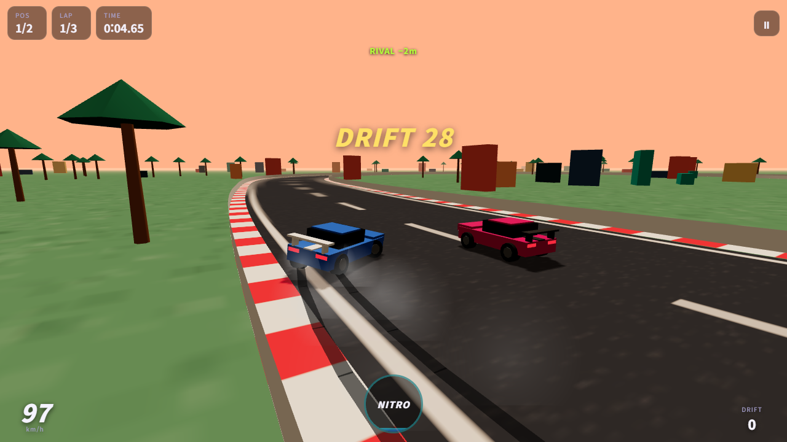
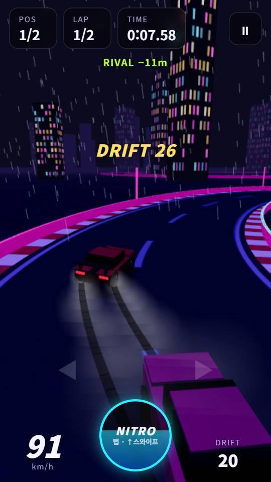
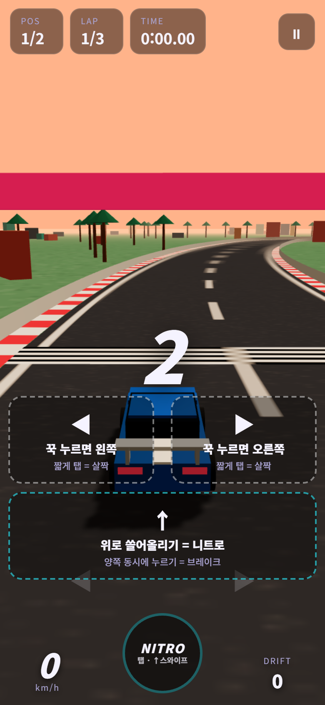
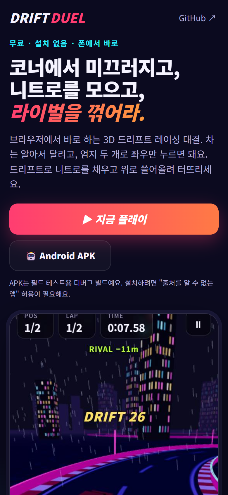

# Drift Duel

**폰에서 바로 하는 3D 드리프트 레이싱 1:1 대결 게임.** 모바일 우선으로 설계했고, 브라우저·홈 화면 설치(PWA)·Android 앱(APK)으로 실행돼요.
엄지 두 개로 코너에서 미끄러지며 니트로를 모으고, AI 라이벌을 꺾으세요.

[](https://github.com/jeiel85/drift-duel/actions/workflows/deploy.yml)
[](https://github.com/jeiel85/drift-duel/actions/workflows/android.yml)
[](LICENSE)

- 🌐 **소개 페이지 + 라이브 데모:** https://jeiel85.github.io/drift-duel/
- 🎮 **바로 플레이:** https://jeiel85.github.io/drift-duel/play.html
- 🤖 **Android APK(릴리스 서명):** https://github.com/jeiel85/drift-duel/releases/latest/download/drift-duel.apk



<p align="center">
  
  
  
</p>

## 특징

| | |
|---|---|
| 🌀 **드리프트 물리** | 속도를 낸 채 크게 꺾으면 횡그립이 떨어져 뒤가 미끄러져요. 오버스티어와 그립 회복을 직접 계산하는 아케이드 모델이에요. |
| ⚡ **니트로 & 콤보** | 슬립 각도 × 속도만큼 드리프트 점수와 니트로가 쌓여요. 오래 이어 가면 배율이 ×4까지 오르지만, 벽에 세게 박으면 콤보가 사라져요. |
| 💨 **속도감 연출** | 낮게 붙은 추격 카메라, 속도에 따라 넓어지는 시야와 노면 진동, 12m 간격 도로변 반사봉, 고속·니트로에서 스치는 바람 줄기. OS의 '동작 줄이기'를 켜면 진동과 바람 줄기는 꺼져요. |
| 🤖 **AI 라이벌 3단계** | 라이벌도 플레이어와 같은 물리 엔진으로 달려요(Easy / Normal / Hard). |
| 🗺️ **트랙 3종** | Sunset Harbor(3랩), Red Canyon(2랩), 그립이 10% 낮은 빗길 Neon Rain(2랩). |
| 🏎️ **자동차 4종** | Street · Muscle · Off-Road · Super. Super(Zenith R)는 Hard 라이벌을 한 번 이기면 열려요. |
| 🧭 **주행 보조** | 터치용 보조(기본 켜짐). 짧은 탭은 살짝, 길게 누르면 크게 꺾이고, 미끄러짐 각도 상한으로 스핀을 막고, 벽 쪽으로 향하면 살짝 되돌려요. |
| 📳 **폰에 맞춘 경험** | 진동 피드백, 전체 화면, 화면 꺼짐 방지, 프레임이 떨어지면 해상도→그림자 순으로 자동 화질 조절. |
| 💾 **기록 저장** | 트랙별 최고 기록, 승수, 해금 상태를 브라우저(localStorage)에 저장해요. |
| 🔊 **합성 사운드** | Web Audio로 엔진음과 타이어 스키드 소리를 실시간 합성해요(음소거 가능). |
| 📦 **에셋 0개** | 텍스처를 전부 캔버스로 절차 생성해서 이미지·사운드 파일이 없어요. |

## 조작법

| 동작 | 모바일 | 키보드 |
|---|---|---|
| 조향 | 화면 왼쪽 / 오른쪽 절반 누르기 — 짧게 탭하면 살짝, 꾹 누르면 크게 | `←` `→` 또는 `A` `D` |
| 니트로 | 아무 데서나 **위로 쓸어올리기** 또는 `NITRO` 탭 — 게이지가 빌 때까지 부스트, 다시 탭하면 중지 | `Space` 또는 `Shift` 누르고 있기 |
| 브레이크 · 후진 | 양쪽 동시에 누르기 | `↓` 또는 `S` |
| 일시정지 | 우측 상단 `⏸` / Android 뒤로 버튼 | `P` 또는 `Esc` |

가속은 자동이에요. 코너 입구에서 일찍 꺾어 드리프트를 시작하고, 출구에서 손을 떼면 그립이 돌아와요.
조향하던 엄지를 떼지 않고도 니트로를 쓸 수 있게 쓸어올리기 제스처를 넣었어요. 처음 5판은 카운트다운 동안 조작 안내가 떠요.

### 주행 보조가 실제로 얼마나 도움이 되나

on/off 조향만 하고 150ms 늦게 반응하는 "엄지 플레이어"를 시뮬레이션해서 비교했어요([`test/assist.test.js`](test/assist.test.js)).

| Neon Rain · Bruiser V8 | 보조 끔 | 보조 켬 |
|---|---|---|
| 벽 충돌 | 22회 | 0회 |
| 스핀(슬립 1 rad 초과) | 발생 | 없음(상한 0.6 rad) |

보조를 켜도 길게 꺾으면 드리프트는 그대로 걸려요. 메뉴에서 끌 수 있어요.

## 동작 원리

- **차량 물리** ([`src/game/physics.js`](src/game/physics.js)) — 매 스텝 속도를 전방/횡방향으로 나누고, 횡속도를 그립 계수로 지수 감쇠시켜요.
  드리프트 중에는 그립이 크게 낮아져서 차체가 회전해도 속도 방향이 늦게 따라오고, 그 차이가 곧 슬립 각도예요.
  물리는 120Hz 고정 스텝으로 돌아가서 프레임레이트와 상관없이 같은 결과가 나와요.
- **트랙** ([`src/game/track.js`](src/game/track.js)) — 제어점을 centripetal Catmull–Rom 스플라인으로 잇고 2m 간격으로 다시 샘플링해요.
  최근접 지점 탐색으로 랩 진행도와 차선 이탈을 계산하고, 벽 충돌은 진행 방향 성분만 남기고 바깥 방향 속도를 없애요.
- **AI** ([`src/game/ai.js`](src/game/ai.js)) — 속도에 비례하는 전방 주시점을 따라가고, 앞쪽 곡률로 코너 진입 속도를 계산해 브레이크를 밟아요.
  역조향으로 미끄러짐을 잡아요.
- **렌더링** ([`src/render/`](src/render)) — Three.js. 트랙은 리본 메시, 소품은 InstancedMesh, 스키드 마크는 풀링된 인스턴스예요.

## Android 앱 (APK)

[Capacitor](https://capacitorjs.com/)로 같은 웹 게임을 Android 네이티브 앱으로 감쌌어요. 앱은 소개 페이지 없이 바로 게임으로 시작해요.

- **몰입형 전체 화면:** 상태바와 내비게이션 바를 숨기고, 가장자리를 쓸면 잠깐 보여요.
- **화면 유지:** 게임 중에는 화면이 꺼지지 않아요.
- **진동:** 진동 권한을 넣어서 앱에서도 햅틱이 동작해요.
- **뒤로 버튼:** 레이스 중에는 일시정지, 일시정지 중에는 재개, 결과 화면에서는 메뉴로, 메뉴에서는 앱을 종료해요.
- **오프라인:** 에셋이 전부 APK 안에 있어서 오프라인에서도 플레이할 수 있어요.

`v*` 태그를 올리면 [`android.yml`](.github/workflows/android.yml)이 **릴리스 키로 서명한** APK와 AAB를 빌드해 릴리스에 `drift-duel.apk`·`drift-duel.aab`로 첨부해요.
스토어 밖에서 받은 APK라 설치하려면 "출처를 알 수 없는 앱" 허용이 필요해요. Play 스토어에는 AAB를 올리면 돼요.

### 릴리스 서명

| 위치 | 서명 정보를 읽는 곳 |
|---|---|
| 로컬 | `.keystore/release-signing.properties` + `.keystore/drift-duel-upload.jks` (git 제외, 저장소에 올리지 않음) |
| CI | 저장소 Secrets `ANDROID_KEYSTORE_BASE64` · `ANDROID_KEYSTORE_PASSWORD` · `ANDROID_KEY_ALIAS` · `ANDROID_KEY_PASSWORD` |

둘 다 같은 키스토어예요. CI는 빌드한 APK의 인증서 SHA-256이
`6c1f643a…2769cedf`(워크플로의 `EXPECTED_CERT_SHA256`)와 다르면 실패해요. 서명 정보가 없으면 release 빌드는 서명 안 된 APK를 만드는 대신 에러로 멈춰요.

> ⚠️ 키스토어를 잃어버리면 같은 앱으로 업데이트를 낼 수 없어요. 원본은 로컬 `.keystore/`에 있고, 백업은 저장소 밖에 따로 보관해요.

로컬 빌드(JDK 21과 Android SDK 필요):

```bash
npm run android:apk         # dist-app 빌드 → cap sync → 서명된 assembleRelease + bundleRelease
npm run android:apk:debug   # 서명 정보 없이 디버그 APK만
```

결과물은 `android/app/build/outputs/apk/release/app-release.apk`와 `android/app/build/outputs/bundle/release/app-release.aab`예요.
Android Studio로 열려면 `npx cap open android`를 실행하세요.

## 개발

Node.js 22.12 이상이 필요해요.

```bash
npm install
npm run dev      # http://localhost:5173 — 소개 페이지, /play.html — 게임
npm test         # Vitest: 트랙 형상, 물리, 랩 계산, 드리프트 점수, AI 완주, 저장·오디오·오류 처리
npm run test:e2e # Playwright: 실제 브라우저(데스크톱·모바일)에서 레이스·터치·랜딩·복구 흐름
npm run build    # dist/ 에 정적 사이트 생성
npm run preview  # 빌드 결과 미리보기
```

`play.html`은 URL 파라미터로 바로 시작할 수 있어요. 예: `play.html?track=neon&car=bruiser&skill=hard&autostart=1`

### 프로젝트 구조

```
index.html            소개 페이지(모바일: 포스터 → 전체 화면 게임, 데스크톱: 라이브 데모 iframe)
play.html             게임
android/              Capacitor Android 프로젝트(네이티브 셸)
capacitor.config.json 앱 ID·이름·웹 번들 경로
scripts/app-index.mjs 앱 빌드에서 게임 화면을 index.html로 만드는 스크립트
src/
  game/               렌더링과 무관한 순수 로직 — 모두 단위 테스트 대상
    physics.js        차량 물리, 벽 충돌
    track.js          스플라인 트랙, 최근접 탐색, 곡률
    tracks.js         트랙 레이아웃과 테마
    cars.js           자동차 스펙
    race.js           랩·진행도·순위·드리프트 점수
    ai.js             라이벌 AI
    input.js          키보드·터치 입력(쓸어올리기 니트로 포함)
    device.js         진동·전체 화면·화면 유지·Android 뒤로 버튼
    audio.js          Web Audio 합성음
    storage.js        기록 저장
  render/             Three.js 씬 구성(월드, 차량, 이펙트, 텍스처)
  play.js             게임 루프와 화면 흐름
test/                 Vitest 테스트
```

### 테스트가 보장하는 것

- 모든 트랙이 겹치지 않고, 가장 급한 코너도 반경 18m 이상이에요.
- 모든 차가 최고 속도를 넘지 않고, 드리프트 후 그립을 되찾아요.
- 벽에 부딪히면 트랙 안으로 돌아오고, 역주행으로는 랩이 올라가지 않아요.
- 모든 트랙 × 모든 차 조합에서 Hard AI가 벽에 거의 부딪히지 않고 완주해요. Easy는 Hard보다 확실히 느려요.
- 주행 보조를 켜면 길게 꺾어도 스핀하지 않고, 짧은 탭은 작은 보정이 되고, 엄지 플레이어가 모든 트랙을 벽 충돌 1회 이하로 완주해요.
- 벽에 끼어 2.5초 넘게 못 움직이면 같은 위치의 트랙 중앙으로 복귀해요. 카운트다운처럼 입력이 없을 때는 동작하지 않아요.
- 손상된 저장 데이터, 거부되거나 iOS에서 중단된 오디오, AudioContext 생성 실패가 게임을 멈추지 않아요.

E2E 테스트(`e2e/`)가 실제 브라우저에서 확인하는 것:

- **레이스 흐름:** 카운트다운 → 드리프트 → 일시정지 → 니트로 → 완주 → 결과·저장
- **터치:** 탭과 홀드 조향, 쓸어올리기 니트로, 양쪽 브레이크, 조작 안내
- **모바일 랜딩:** 넘침 없음, 44px 터치 영역, 고정 버튼, 포스터 → 게임 이동
- **복구와 안정성:** WebGL 컨텍스트 손실 후 복구, 게임 루프 오류 시 신고 화면, 손상된 저장 데이터

로컬에서는 설치된 Chrome을 쓰고, CI는 Playwright Chromium을 설치해 같은 테스트를 돌려요.

### 오류 신고

게임 루프에서 오류가 나면 게임을 멈추고 "다시 시작"과 "문제 신고하기" 버튼을 보여 줘요.
신고 링크는 버전, 브라우저, 화면 상태, 최근 오류 5개가 채워진 GitHub 이슈 작성 화면을 열어요.
서버로 자동 전송하지 않고, 플레이어가 직접 제출해야만 전달돼요.

## 배포

`main`에 푸시하면 GitHub Actions([`deploy.yml`](.github/workflows/deploy.yml))가 단위 테스트와 E2E 테스트를 통과한 경우에만 빌드해서 GitHub Pages로 배포해요. PR에서는 테스트만 돌아요.
three.js는 별도 청크로 분리돼 있어서, 게임 코드가 바뀌어도 재방문자는 게임 청크(gzip 18 kB)만 다시 받아요.
`v*` 태그는 [`android.yml`](.github/workflows/android.yml)이 APK를 빌드해 릴리스에 첨부해요.

## 아직 없는 것

- 실시간 온라인 멀티플레이(서버가 필요해서 지금은 AI 라이벌과 대결해요)
- 차량 간 충돌(라이벌은 고스트처럼 통과해요)
- 게임패드 지원
- iOS 앱(Capacitor iOS는 macOS·Xcode가 필요해요. 그 전까지 iPhone은 Safari "홈 화면에 추가"로 쓸 수 있어요)
- Play 스토어 등록(릴리스 서명된 AAB는 태그마다 생성돼요)

## 라이선스

[MIT](LICENSE). 모바일 드리프트 레이싱 장르에서 영감을 받은 개인 프로젝트이며, 특정 상용 게임과는 관련이 없어요.
