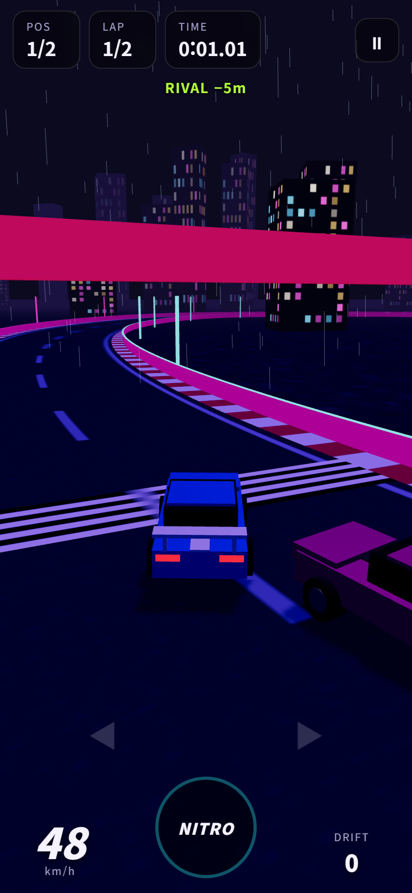
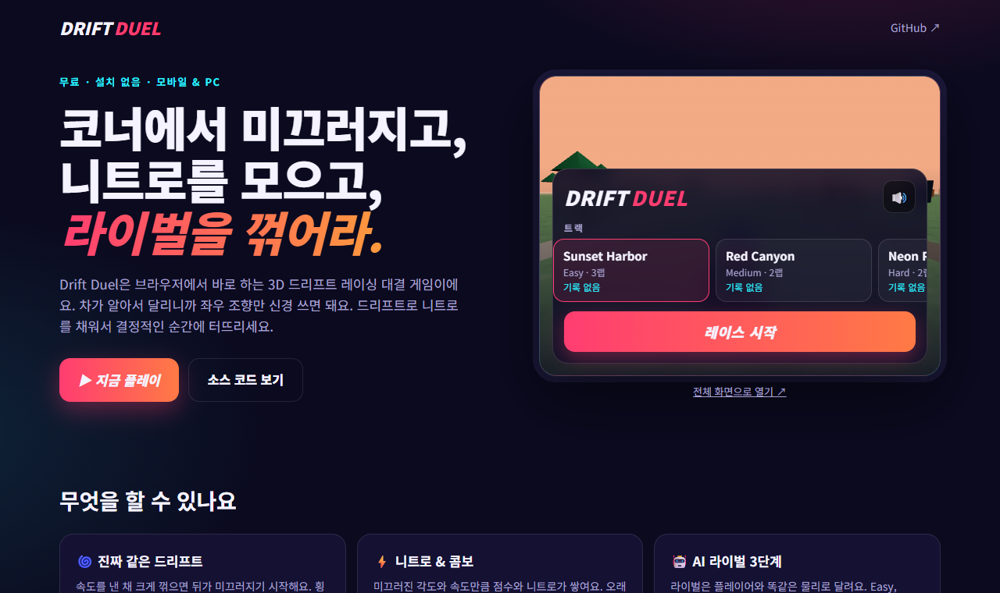

# Drift Duel

**브라우저에서 바로 하는 3D 드리프트 레이싱 1:1 대결 게임.** 설치 없이 모바일과 PC에서 실행돼요.
코너에서 미끄러지며 니트로를 모으고, AI 라이벌을 꺾으세요.

[](https://github.com/jeiel85/drift-duel/actions/workflows/deploy.yml)
[](LICENSE)

- 🌐 **소개 페이지 + 라이브 데모:** https://jeiel85.github.io/drift-duel/
- 🎮 **바로 플레이:** https://jeiel85.github.io/drift-duel/play.html


<p align="center">
  
  
</p>

## 특징

| | |
|---|---|
| 🌀 **드리프트 물리** | 속도를 낸 채 크게 꺾으면 횡그립이 떨어져 뒤가 미끄러져요. 오버스티어와 그립 회복을 직접 계산하는 아케이드 모델이에요. |
| ⚡ **니트로 & 콤보** | 슬립 각도 × 속도만큼 드리프트 점수와 니트로가 쌓여요. 오래 이어 가면 배율이 ×4까지 오르지만, 벽에 세게 박으면 콤보가 사라져요. |
| 🤖 **AI 라이벌 3단계** | 라이벌도 플레이어와 같은 물리 엔진으로 달려요(Easy / Normal / Hard). |
| 🗺️ **트랙 3종** | Sunset Harbor(3랩), Red Canyon(2랩), 그립이 10% 낮은 빗길 Neon Rain(2랩). |
| 🏎️ **자동차 4종** | Street · Muscle · Off-Road · Super. Super(Zenith R)는 Hard 라이벌을 한 번 이기면 열려요. |
| 💾 **기록 저장** | 트랙별 최고 기록, 승수, 해금 상태를 브라우저(localStorage)에 저장해요. |
| 🔊 **합성 사운드** | Web Audio로 엔진음과 타이어 스키드 소리를 실시간 합성해요(음소거 가능). |
| 📦 **에셋 0개** | 텍스처를 전부 캔버스로 절차 생성해서 이미지·사운드 파일이 없어요. |

## 조작법

| 동작 | 모바일 | 키보드 |
|---|---|---|
| 조향 | 화면 왼쪽 / 오른쪽 절반 누르고 있기 | `←` `→` 또는 `A` `D` |
| 브레이크 · 후진 | 양쪽 동시에 누르기 | `↓` 또는 `S` |
| 니트로 | `NITRO` 버튼 누르고 있기 | `Space` 또는 `Shift` |
| 일시정지 | 우측 상단 `⏸` | `P` 또는 `Esc` |

가속은 자동이에요. 코너 입구에서 일찍 꺾어 드리프트를 시작하고, 출구에서 조향을 풀면 그립이 돌아와요.

## 동작 원리

- **차량 물리** ([`src/game/physics.js`](src/game/physics.js)) — 매 스텝 속도를 전방/횡방향으로 나누고, 횡속도를 그립 계수로 지수 감쇠시켜요.
  드리프트 중에는 그립이 크게 낮아져서 차체가 회전해도 속도 방향이 늦게 따라오고, 그 차이가 곧 슬립 각도예요.
  물리는 120Hz 고정 스텝으로 돌아가서 프레임레이트와 상관없이 같은 결과가 나와요.
- **트랙** ([`src/game/track.js`](src/game/track.js)) — 제어점을 centripetal Catmull–Rom 스플라인으로 잇고 2m 간격으로 다시 샘플링해요.
  최근접 지점 탐색으로 랩 진행도와 차선 이탈을 계산하고, 벽 충돌은 진행 방향 성분만 남기고 바깥 방향 속도를 없애요.
- **AI** ([`src/game/ai.js`](src/game/ai.js)) — 속도에 비례하는 전방 주시점을 따라가고, 앞쪽 곡률로 코너 진입 속도를 계산해 브레이크를 밟아요.
  역조향으로 미끄러짐을 잡아요.
- **렌더링** ([`src/render/`](src/render)) — Three.js. 트랙은 리본 메시, 소품은 InstancedMesh, 스키드 마크는 풀링된 인스턴스예요.

## 개발

Node.js 22.12 이상이 필요해요.

```bash
npm install
npm run dev      # http://localhost:5173 — 소개 페이지, /play.html — 게임
npm test         # Vitest: 트랙 형상, 물리, 랩 계산, 드리프트 점수, AI 완주
npm run build    # dist/ 에 정적 사이트 생성
npm run preview  # 빌드 결과 미리보기
```

`play.html`은 URL 파라미터로 바로 시작할 수 있어요. 예: `play.html?track=neon&car=bruiser&skill=hard&autostart=1`

### 프로젝트 구조

```
index.html            소개 페이지(라이브 데모 iframe 포함)
play.html             게임
src/
  game/               렌더링과 무관한 순수 로직 — 모두 단위 테스트 대상
    physics.js        차량 물리, 벽 충돌
    track.js          스플라인 트랙, 최근접 탐색, 곡률
    tracks.js         트랙 레이아웃과 테마
    cars.js           자동차 스펙
    race.js           랩·진행도·순위·드리프트 점수
    ai.js             라이벌 AI
    input.js          키보드·터치 입력
    audio.js          Web Audio 합성음
    storage.js        기록 저장
  render/             Three.js 씬 구성(월드, 차량, 이펙트, 텍스처)
  play.js             게임 루프와 화면 흐름
test/                 Vitest 테스트
```

### 테스트가 보장하는 것

- 모든 트랙이 겹치지 않고, 가장 급한 코너도 반경 18m 이상이에요.
- 모든 차가 최고 속도를 넘지 않고, 드리프트 후 그립을 되찾아요.
- 벽에 부딪히면 트랙 안으로 돌아오고, 역주행으로는 랩이 올라가지 않아요.
- 모든 트랙 × 모든 차 조합에서 Hard AI가 벽에 거의 부딪히지 않고 완주해요. Easy는 Hard보다 확실히 느려요.

## 배포

`main`에 푸시하면 GitHub Actions([`deploy.yml`](.github/workflows/deploy.yml))가 테스트하고, 빌드한 뒤 GitHub Pages로 배포해요.

## 아직 없는 것

- 실시간 온라인 멀티플레이(서버가 필요해서 지금은 AI 라이벌과 대결해요)
- 차량 간 충돌(라이벌은 고스트처럼 통과해요)
- 게임패드 지원

## 라이선스

[MIT](LICENSE). 모바일 드리프트 레이싱 장르에서 영감을 받은 개인 프로젝트이며, 특정 상용 게임과는 관련이 없어요.
